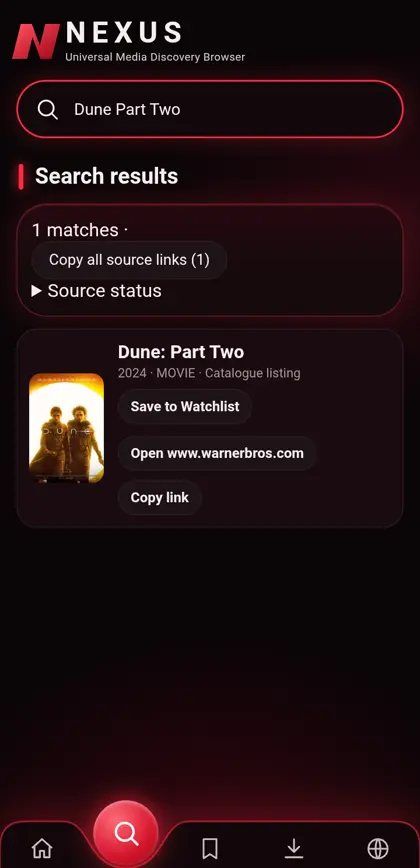

<h1 align="center">NEXUS for Android</h1>

Search movies, anime and cartoons. Keep the original source links and your watchlist on your phone.

  <a href="https://github.com/0xSnipFi/nexus-android/releases/latest/download/NEXUS-debug.apk"><b>Download the Android APK</b></a> ·
  <a href="https://github.com/0xSnipFi/nexus-android/releases/latest">Release notes &amp; checksum</a> ·
  <a href="CONTRIBUTING.md">Contribute</a>

## See it on a phone

| Discover | Find a movie | Find a cartoon |
| :---: | :---: | :---: |
|  |  |  |

These are captures from the Android app. Tap a screenshot to inspect it. Result counts and source availability may change.

## Search sources in the development build

Search returns only title pages from connected sites in the submitted-source registry. Try **Anime → Naruto**. Source status shows matches after filters, network failures, and links to interactive search pages. If no connected source returns a match, there is no external catalogue fallback. The screenshots above show earlier builds.

## Install

Download the APK from the link above and open it on Android 10 or newer. If Android asks, allow installation for the app you used to open the file. For a phone connected by USB debugging:

~~~sh
adb install -r NEXUS-debug.apk
~~~

**Development build: 0.4.8 (12), debug-signed.** The release link above points to the latest published APK, which may be older. This is a development APK, not a Play Store release. If Android reports an incompatible signature, an existing installation was signed with another key. Uninstalling removes local watchlist and history, so do not uninstall without saving what you need.

**বাংলায় শুরু করুন:** APK ইনস্টল করে Search-এ নাম লিখুন। ফলের পাশে **Copy link** চাপলে মূল পেজের ঠিকানা কপি হবে। পরে দেখতে **Save to Watchlist** চাপুন।

## What works today

The app searches supported listings from the submitted sites, groups source links by result, displays available artwork and stores recent searches and saved titles on the phone. No NEXUS account is required. Opening an external source connects to that website.

The interface has been checked on physical Android 10 and Android 15 phones at 720 × 1600 and 1080 × 2400. Not every Android version or screen size has been verified. A catalogue match is not proof of playable video. Downloads accepts direct HTTPS video, audio and PDF file links, including supported downloads offered by an original website. Confirm the file and host before saving it. Android manages the transfer; open, share, cancel or remove it from the Downloads tab. Streaming manifests, protected players, signed-in-only files and stream extraction are not supported. NEXUS checks same-host search forms from the submitted list. Sites that require JavaScript or human verification can be opened from Source status. The browser blocks automatic pop-ups and filters requests using the bundled [AdAway hosts list](https://github.com/AdAway/adaway.github.io/blob/master/hosts.txt), distributed under [CC BY 3.0](https://creativecommons.org/licenses/by/3.0/). Tap Shield on or Shield off to change filtering for the displayed site. A user-selected link to another host prompts before opening.

## Build from source

Install JDK 17, Android SDK Platform 36 and Build Tools 35.0.0. Configure ANDROID_HOME or set sdk.dir in your own local.properties.

~~~sh
git clone https://github.com/0xSnipFi/nexus-android.git
cd nexus-android
./gradlew :domain:test :app:assembleDebug :app:lintDebug
~~~

On Windows use gradlew.bat. The APK is written to app/build/outputs/apk/debug/app-debug.apk.

| Source | Where to start |
| --- | --- |
| Interface | [Responsive HTML and navigation](app/src/main/assets/prototype.html) · [Android integration](app/src/main/java/app/nexus/discovery/Prototype.kt) |
| Discovery | [Catalogue selection and ranking](app/src/main/java/app/nexus/discovery/Catalogue.kt) · [Search domain and tests](domain/) |
| Maintenance | [Build checks](.github/workflows/android.yml) · [Historical implementation records](docs/) |

## Help improve NEXUS

[Report a bug](https://github.com/0xSnipFi/nexus-android/issues/new?template=bug.yml), [suggest a feature](https://github.com/0xSnipFi/nexus-android/issues/new?template=feature.yml), or [send a pull request](CONTRIBUTING.md). Reports that include the Android version, search query and expected result are particularly useful.

The [anime dataset notice](app/src/main/assets/catalog-license.txt) and [movie dataset notice](app/src/main/assets/movie-data-license.txt) apply to their respective datasets; neither grants rights to third-party artwork.

