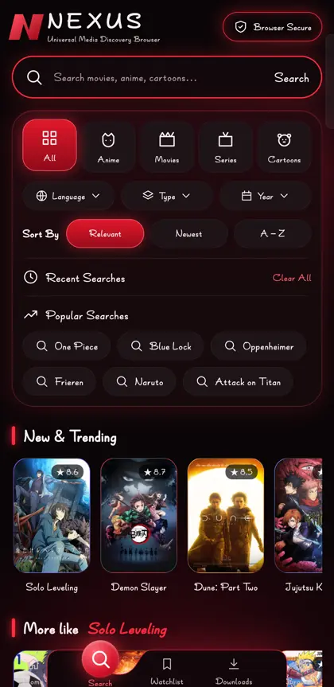
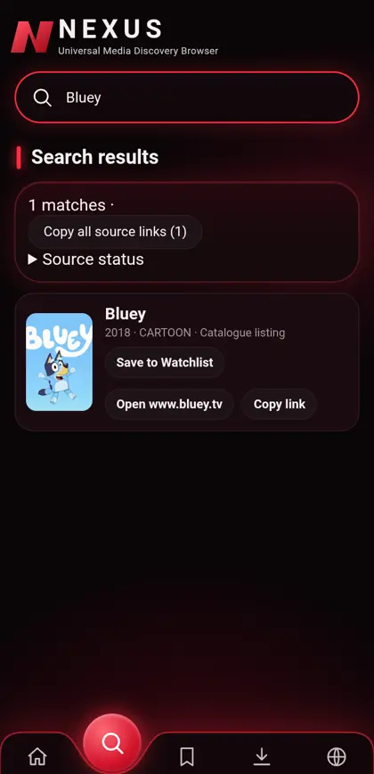

<h1 align="center">NEXUS for Android</h1>

Search movies, anime and cartoons. Keep the original source links and your watchlist on your phone.

  <a href="https://github.com/0xSnipFi/nexus-android/releases/latest/download/NEXUS-debug.apk"><b>Download the Android APK</b></a> ·
  <a href="https://github.com/0xSnipFi/nexus-android/releases/latest">Release notes &amp; checksum</a> ·
  <a href="CONTRIBUTING.md">Contribute</a>

## See it on a phone

| Discover | Find a movie | Find a cartoon |
| :---: | :---: | :---: |
|  |  |  |

These are captures from the Android app. Tap a screenshot to inspect it. Result counts and source availability may change.

## Try these searches

- **Movies → Dune Part Two.** The tested search found the 2024 film and its Warner Bros. source page. Use **Copy link** for one URL or **Copy all source links** for a deduplicated list.
- **Cartoons → Bluey.** Save the 2018 title to **Watchlist**, open the Watchlist tab, then tap the title to visit the original site. This flow was verified on a physical phone.
- **Anime → Solo Leveling Hindi dub.** The tested search returned seven catalogue matches. A language note identifies a documented dub where available; it does not verify audio playback in your region.

## Install

Download the APK from the link above and open it on Android 10 or newer. If Android asks, allow installation for the app you used to open the file. For a phone connected by USB debugging:

~~~sh
adb install -r NEXUS-debug.apk
~~~

**Current build: 0.4.2 (6), debug-signed.** This is a development APK, not a Play Store release. If Android reports an incompatible signature, an existing installation was signed with another key. Uninstalling removes local watchlist and history, so do not uninstall without saving what you need.

**বাংলায় শুরু করুন:** APK ইনস্টল করে Search-এ নাম লিখুন। ফলের পাশে **Copy link** চাপলে মূল পেজের ঠিকানা কপি হবে। পরে দেখতে **Save to Watchlist** চাপুন।

## What works today

The app searches local title catalogues and supported online listings, groups source links by result, displays available artwork and stores recent searches and saved titles on the phone. No NEXUS account is required. Opening an external source connects to that website.

The interface has been checked on physical Android 10 and Android 15 phones at 720 × 1600 and 1080 × 2400. Not every Android version or screen size has been verified. A catalogue match is not proof of playable video. Downloads is an empty state in this version; the app does not download movies. The submitted-site list includes sources without active connectors.

## Build from source

Install JDK 17, Android SDK Platform 36 and Build Tools 35.0.0. Configure ANDROID_HOME or set sdk.dir in your own local.properties.

~~~sh
git clone https://github.com/0xSnipFi/nexus-android.git
cd nexus-android
./gradlew :domain:test :app:assembleDebug :app:lintDebug
~~~

On Windows use gradlew.bat. The APK is written to app/build/outputs/apk/debug/app-debug.apk.

| Source | Where to start |
| --- | --- |
| Interface | [Responsive HTML and navigation](app/src/main/assets/prototype.html) · [Android integration](app/src/main/java/app/nexus/discovery/Prototype.kt) |
| Discovery | [Catalogue selection and ranking](app/src/main/java/app/nexus/discovery/Catalogue.kt) · [Search domain and tests](domain/) |
| Maintenance | [Build checks](.github/workflows/android.yml) · [Historical implementation records](docs/) |

## Help improve NEXUS

[Report a bug](https://github.com/0xSnipFi/nexus-android/issues/new?template=bug.yml), [suggest a feature](https://github.com/0xSnipFi/nexus-android/issues/new?template=feature.yml), or [send a pull request](CONTRIBUTING.md). Reports that include the Android version, search query and expected result are particularly useful.

The [anime dataset notice](app/src/main/assets/catalog-license.txt) and [movie dataset notice](app/src/main/assets/movie-data-license.txt) apply to their respective datasets; neither grants rights to third-party artwork.
